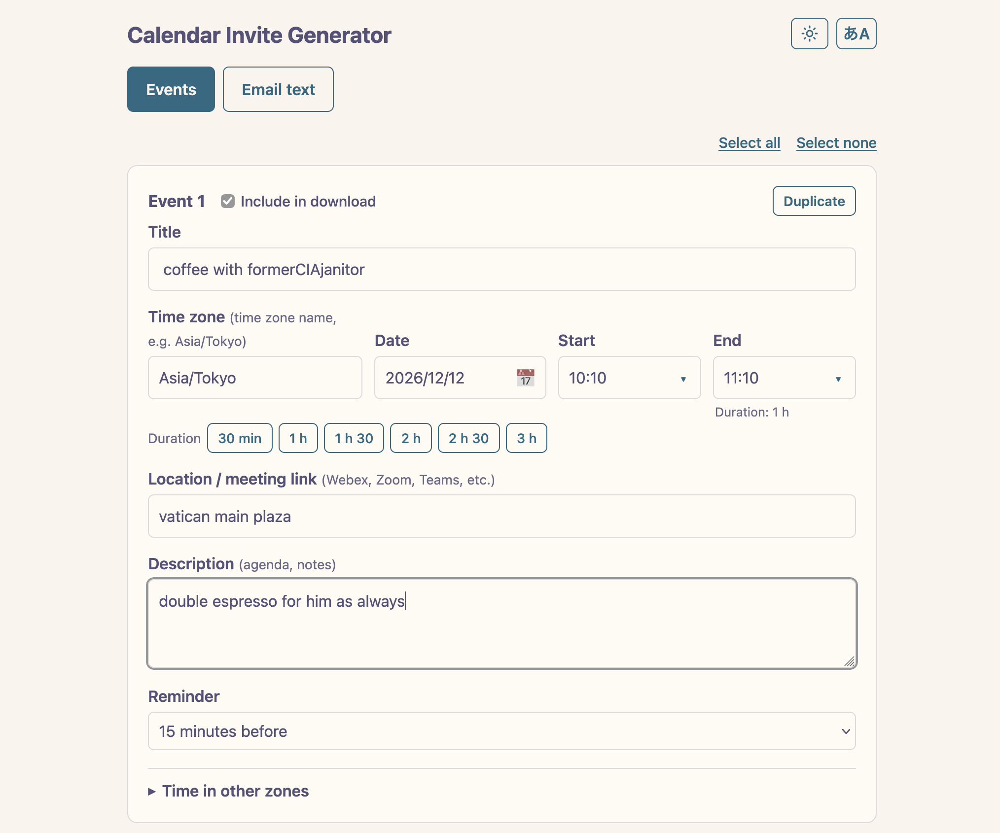

<h1 align="center">

</h1>
<h3 align="center" style="margin: 0; margin-top: 0;">
Calendar Invite Generator — never miss your meeting at 2 am again.
</h3>

---

Create calendar invitations (.ics files) that show the right time in every recipient's time zone.

Attach the file to an email; recipients double-click it to add the events to their calendar.
Everything stays in your browser.

- **Add event** adds a new event. It starts with the previous event's time zone, date and reminder, and its start time is the previous end time.
- **Duplicate** copies an event right below it.
- **Delete event** removes an event (not available on the first one). **Undo** appears for a few seconds.
- **Import .ics file** loads events from an existing .ics file.
- **Clear all** removes all events. Your templates, language, theme, time zone list and email text are kept.
- **End time is optional.** Leave it empty for a meeting with no set end.

## Templates

Use templates for events you create often.

- Saving under an existing name replaces that template.
- Up to 10 templates can be saved.
- If the duration would take the event past midnight, the end time is left empty.
## Checking the time in other zones

Under each event, open **Time in other zones** to see the event time in other time zones.
Use **Modify time zones to check** to add or remove zones.
The list is shared by all events.

## Email text

The **Email text** tab gives you a ready-to-use subject and message for the selected events, with the times shown in each time zone.
Use the copy buttons, then paste them into your email.

To change the wording, open **Template** on the same tab.

<table>
  <tr>
    <td align="left">
      
    </td>
    <td align="right">
      
    </td>
  </tr>
</table>